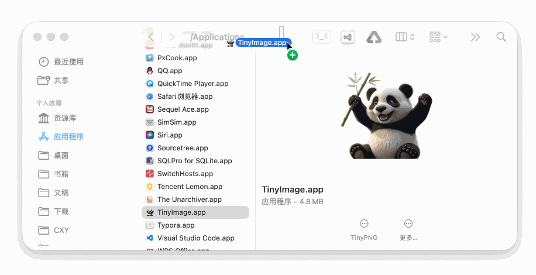
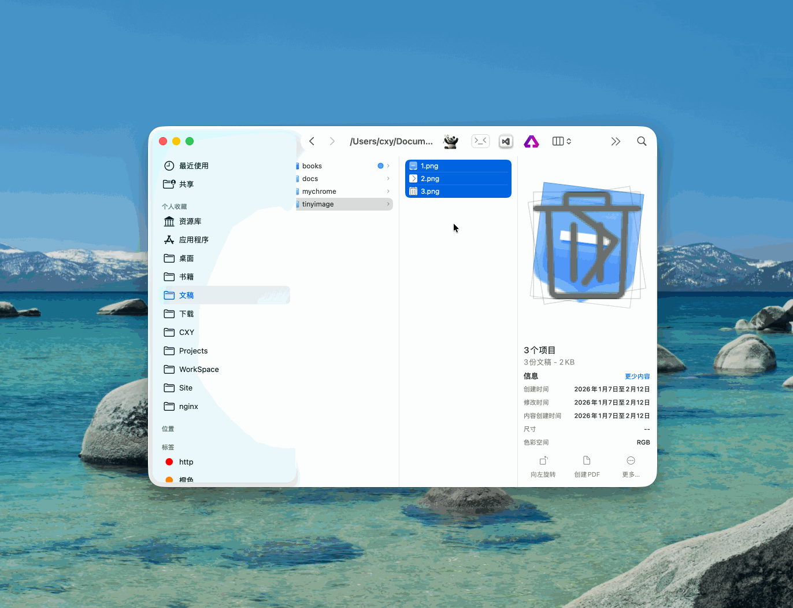
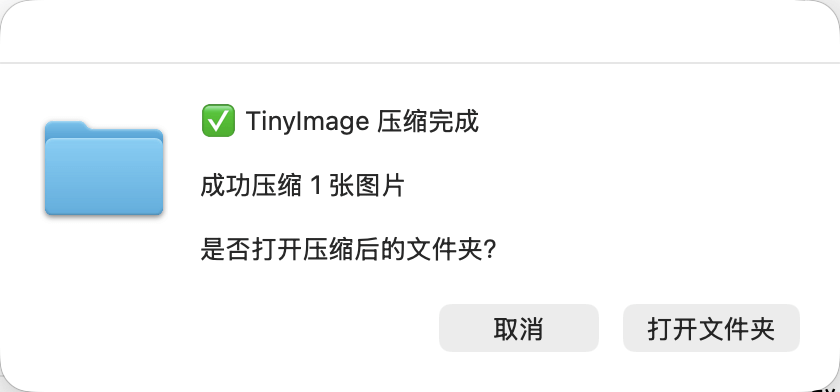
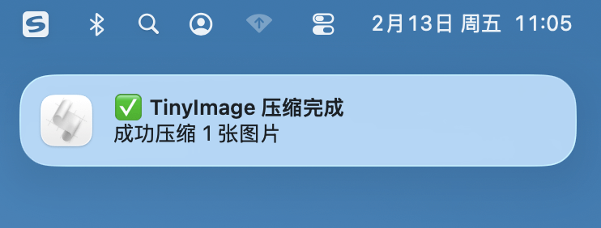
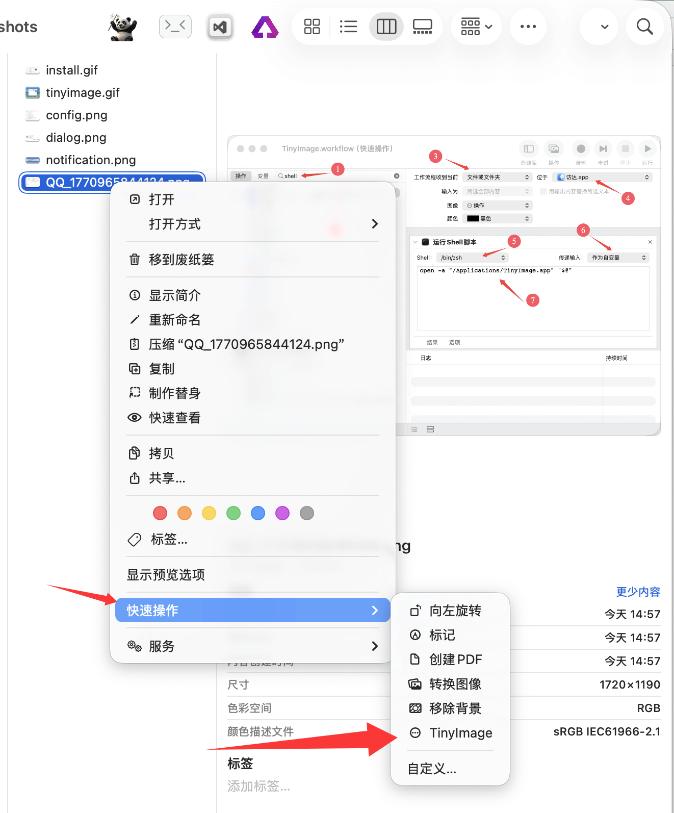
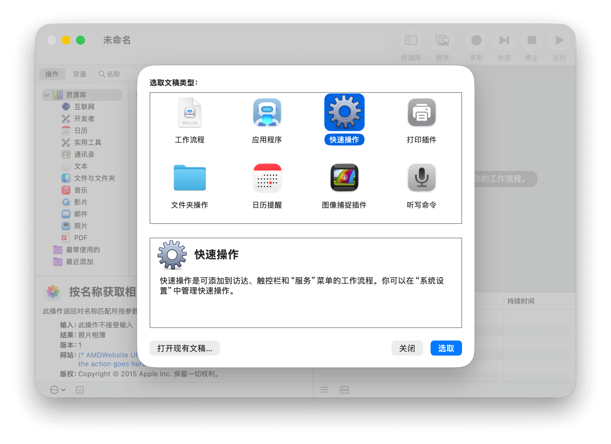
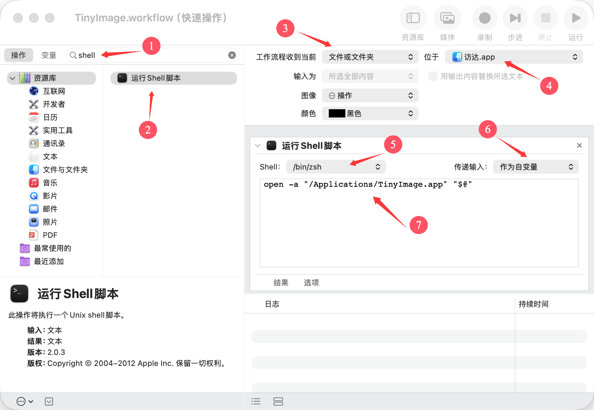
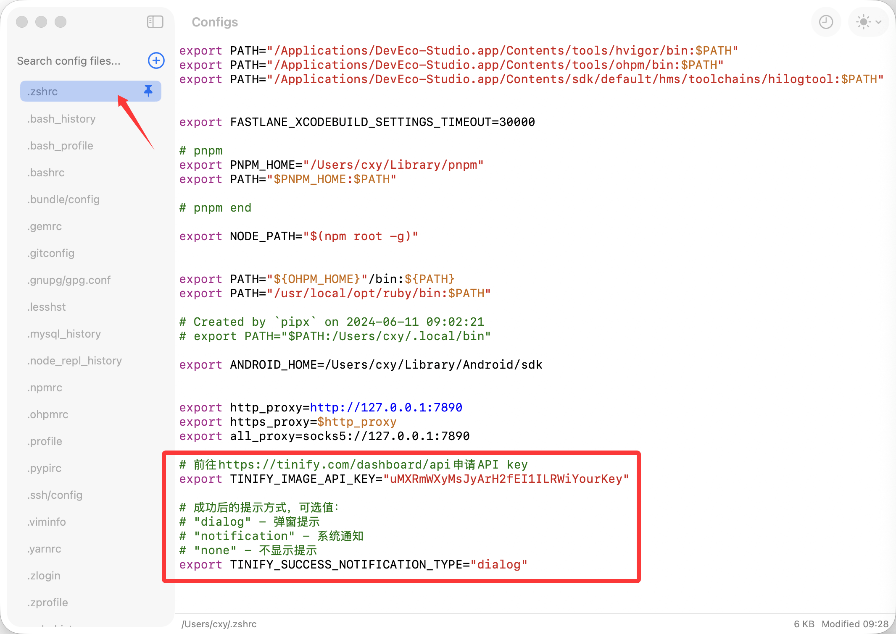

# [TinyImage](https://github.com/iHongRen/TinyImage)

基于 Tinify API 的 macOS 图片压缩工具，一键在 Finder 工具栏压缩图片。

[English README](./README_EN.md)


## 功能

- Finder 工具栏一键压缩
- 支持图片和文件夹批量处理（文件夹会递归处理子目录，跳过隐藏目录、`.app` 与已生成的 `tinified`）
- 支持 PNG、JPG、JPEG、WebP、AVIF 格式
- 灵活提示（弹窗、通知或静默）
- 每月免费压缩 500 张，无 5MB 限制，不够用可多申请几个API Key


## 快速开始

### 安装

在终端执行（推荐）：

```bash
curl -fsSL https://raw.githubusercontent.com/iHongRen/TinyImage/main/install.sh | sh
```

脚本会把最新版本安装到 `/Applications`，并在 `~/.config/tinyimage/config` 生成一份默认配置。若提示没有写入权限，用 `sudo sh` 重新执行即可。

也可以手动安装：

1. 下载 [TinyImage.dmg](https://github.com/iHongRen/TinyImage/releases)
2. 双击 DMG，将 `TinyImage.app` 拖到 `/Applications`（应用程序）文件夹
3. 打开终端，执行以下命令去除隔离属性：
   ```bash
   xattr -dr com.apple.quarantine /Applications/TinyImage.app
   ```
4. 按住 `⌘ Command` 键，用鼠标将 `TinyImage.app` 拖到 Finder 工具栏




### 申请 API Key

前往 [Tinify 官网](https://tinify.com/developers) 注册，免费获得 API Key。


### 配置环境变量

复制下方命令，**将 `your_api_key_here` 替换为你的真实 API Key**，粘贴到终端执行：

#### 推荐方式（一条命令自动完成）

如果你使用的是 **zsh**（默认）：
```bash
echo 'export TINIFY_IMAGE_API_KEY="your_api_key_here"' >> ~/.zshrc && echo 'export TINIFY_SUCCESS_NOTIFICATION_TYPE="dialog"' >> ~/.zshrc && source ~/.zshrc
```

如果你使用的是 **bash**：
```bash
echo 'export TINIFY_IMAGE_API_KEY="your_api_key_here"' >> ~/.bash_profile && echo 'export TINIFY_SUCCESS_NOTIFICATION_TYPE="dialog"' >> ~/.bash_profile && source ~/.bash_profile
```

#### 验证是否配置成功

执行命令检查：
```bash
echo $TINIFY_IMAGE_API_KEY
```

如果显示你的 API Key，说明配置成功 ✅


### 配置文件（可选）

也可以把配置写入 `~/.config/tinyimage/config`，对从 Finder 直接启动的 App 同样生效：

```bash
mkdir -p ~/.config/tinyimage
curl -fsSL https://raw.githubusercontent.com/iHongRen/TinyImage/main/config.example -o ~/.config/tinyimage/config
```

已在仓库目录中时，也可以直接 `cp config.example ~/.config/tinyimage/config`。

| 配置项 | 说明 | 默认 |
|---|---|---|
| `API_KEY` | Tinify API Key | 空 |
| `NOTIFY` | 提示方式：`dialog` 弹窗 / `notification` 系统通知 / `none` 静默 | `notification` |
| `DEBUG` | 调试模式：`1` 开启 / `0` 关闭 | `0` |

优先级：脚本内硬编码 > 环境变量 > 配置文件 > `~/.zshrc` 等 profile > 默认值。已有的环境变量配置无需改动，继续有效；配置文件在每次运行时读取，改完立即生效。


### 开始使用

1. 在 Finder 中选择要压缩的图片或文件夹
2. 点击工具栏上的 TinyImage 图标
3. 首次使用需要同意权限请求
4. 等待完成（需要上传→压缩→下载）

压缩后的图片保存在源目录下的 `tinified` 文件夹中（子目录各自生成一个 `tinified`，已存在时自动改用 `tinified(1)`、`tinified(2)`……）。




## 提示方式配置

修改 `TINIFY_SUCCESS_NOTIFICATION_TYPE` 环境变量的值：

| 值 | 效果 |
|---|---|
| `dialog` | 弹窗提示（**推荐**） |
| `notification` | 系统通知 |
| `none` | 静默（无提示） |

`dialog` 效果：



`notification` 效果：



也可以直接写在配置文件 `~/.config/tinyimage/config` 里（`NOTIFY=dialog`），从 Finder 启动时同样生效。

修改方法（同样替换 API Key）：
```bash
# zsh 用户
echo 'export TINIFY_SUCCESS_NOTIFICATION_TYPE="notification"' >> ~/.zshrc && source ~/.zshrc

# bash 用户
echo 'export TINIFY_SUCCESS_NOTIFICATION_TYPE="notification"' >> ~/.bash_profile && source ~/.bash_profile
```


## 命令行使用（可选）

```bash
# 压缩单个文件
./TinyImage.sh image.jpg

# 压缩多个文件
./TinyImage.sh image1.jpg image2.png image3.webp

# 压缩整个文件夹
./TinyImage.sh /path/to/images/
```


## 右键菜单快速操作（可选）

想要右键菜单中也能使用 TinyImage？

1. 打开「自动操作」应用
2. 新建 → 快速操作
3. 在流程中添加「运行 Shell 脚本」
4. 粘贴以下代码：
   ```bash
   open -a "/Applications/TinyImage.app" "$@"
   ```
5. 保存，命名为 `TinyImage`

现在右键菜单中就会出现 TinyImage 选项。








## 常见问题
**Q: 忘记点同意权限怎么办？**

A: 打开系统设置 → 隐私与安全性 → 自动化 → 找到 TinyImage.app，勾选「访达」权限。

**Q: Finder 工具栏提示"操作运行 Shell 脚本错误"？**

A: 打开自动操作应用，在 Applications 中右键 TinyImage.app → 打开方式 → 自动操作，再直接保存即可。

**Q: 如何修改已配置的 API Key？**

A: 用编辑器打开 `~/.config/tinyimage/config`（或 `~/.zshrc` / `~/.bash_profile`），找到相应行修改并保存，下次运行即生效。

**Q: 如何方便快捷的管理各种配置文件**
A: 推荐使用 [Configs](https://github.com/iHongRen/configEditor)，编辑保存后，环境变量自动生效



## 构建与发布（开发者）

需要 macOS（App 由系统自带的 Automator Stub 组装）：

```bash
./build.sh 1.3.0     # 生成 dist/TinyImage.app
./release.sh 1.3.0   # 构建并上传 dist/TinyImage.dmg 与 dist/TinyImage.zip 到 GitHub Release
bash tests/run.sh    # 运行回归测试（假 curl，无需真实 API Key）
```

`release.sh` 依赖 [GitHub CLI](https://cli.github.com/)，要求当前分支已推送且工作区干净。


## 支持

如果觉得好用，欢迎 [⭐ Star](https://github.com/iHongRen/TinyImage) 支持！

[💖 赞助开发者](https://ihongren.github.io/donate.html)
