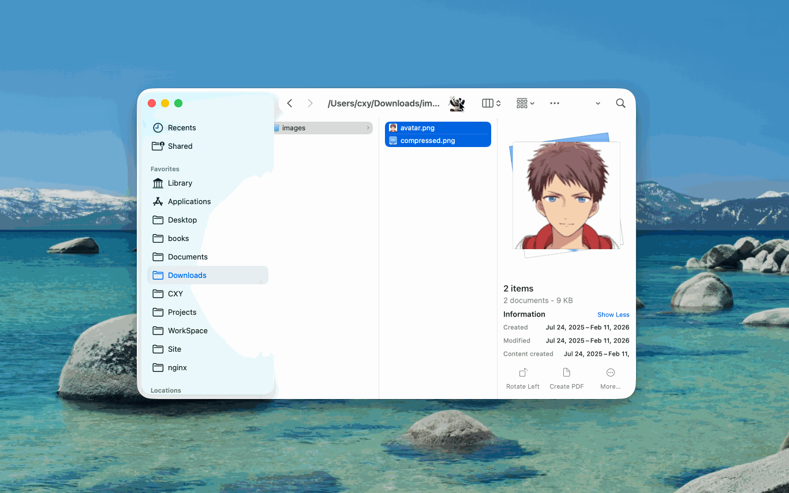
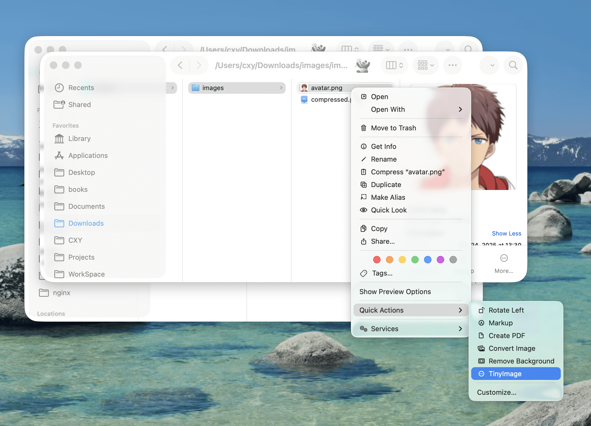

# [TinyImage](https://github.com/iHongRen/TinyImage)

macOS image compression tool based on Tinify API - compress images with one click from Finder toolbar.

[中文 README](./README.md)

## Features

- One-click compression from Finder toolbar
- Batch process images and folders (subfolders are processed recursively)
- Supports PNG, JPG, JPEG, WebP, AVIF formats
- Flexible notifications (dialog, system notification, or silent)
- 500 free compressions per month, no 5MB size limit, request additional API Keys if needed


## Quick Start

### Installation

Run this in Terminal (recommended):

```bash
curl -fsSL https://raw.githubusercontent.com/iHongRen/TinyImage/main/install.sh | sh
```

The script installs the latest version to `/Applications` and creates a default config at `~/.config/tinyimage/config`. If it reports a permission error, rerun with `sudo sh`.

Or install manually:

1. Download [TinyImage.dmg](https://github.com/iHongRen/TinyImage/releases)
2. Double-click the DMG and drag `TinyImage.app` to the `/Applications` folder
3. Open Terminal and run this command to remove quarantine restriction:
   ```bash
   xattr -dr com.apple.quarantine /Applications/TinyImage.app
   ```
4. Hold `⌘ Command` key and drag `TinyImage.app` to the Finder toolbar


### Get API Key

Visit [Tinify Website](https://tinify.com/developers) to sign up and get your free API Key.


### Configure Environment Variables

Copy the command below, **replace `your_api_key_here` with your actual API Key**, then paste and run in Terminal:

#### Recommended Method (Single command)

If you use **zsh** (default):
```bash
echo 'export TINIFY_IMAGE_API_KEY="your_api_key_here"' >> ~/.zshrc && echo 'export TINIFY_SUCCESS_NOTIFICATION_TYPE="dialog"' >> ~/.zshrc && source ~/.zshrc
```

If you use **bash**:
```bash
echo 'export TINIFY_IMAGE_API_KEY="your_api_key_here"' >> ~/.bash_profile && echo 'export TINIFY_SUCCESS_NOTIFICATION_TYPE="dialog"' >> ~/.bash_profile && source ~/.bash_profile
```

#### Verify Configuration

Run this command to verify:
```bash
echo $TINIFY_IMAGE_API_KEY
```

If it displays your API Key, configuration is successful ✅


### Config File (Optional)

You can also put settings in `~/.config/tinyimage/config`, which works even when the app is launched from Finder:

```bash
mkdir -p ~/.config/tinyimage
cp config.example ~/.config/tinyimage/config
```

| Key | Description | Default |
|---|---|---|
| `API_KEY` | Tinify API Key | empty |
| `NOTIFY` | Notification type: `dialog` / `notification` / `none` | `notification` |
| `DEBUG` | Debug mode: `1` on / `0` off | `0` |

Priority: hardcoded in script > environment variables > config file > shell profiles > defaults. Existing environment-variable setups keep working unchanged; the config file is read on every run, so edits take effect immediately.


### Start Using

1. Select images or folders in Finder
2. Click the TinyImage icon in the toolbar
3. Grant permission when prompted on first use
4. Wait for completion (upload → compress → download)

Compressed images are saved in a `tinified` folder next to the source (each subfolder gets its own `tinified`; if one already exists, `tinified(1)`, `tinified(2)`, … is used).




## Notification Preferences

Customize notification type by changing `TINIFY_SUCCESS_NOTIFICATION_TYPE`:

| Value | Effect |
|---|---|
| `dialog` | Dialog prompt (**recommended**) |
| `notification` | System notification |
| `none` | Silent (no notification) |

To change notification type:
```bash
# zsh users
echo 'export TINIFY_SUCCESS_NOTIFICATION_TYPE="notification"' >> ~/.zshrc && source ~/.zshrc

# bash users
echo 'export TINIFY_SUCCESS_NOTIFICATION_TYPE="notification"' >> ~/.bash_profile && source ~/.bash_profile
```


## Command Line Usage (Optional)

```bash
# Compress single image
./TinyImage.sh image.jpg

# Compress multiple images
./TinyImage.sh image1.jpg image2.png image3.webp

# Compress entire folder
./TinyImage.sh /path/to/images/
```


## Right-Click Context Menu (Optional)

Want to add TinyImage to Finder's right-click menu?

1. Open "Automator" application
2. New → Quick Action
3. Add "Run Shell Script" to the workflow
4. Paste this code:
   ```bash
   open -a "/Applications/TinyImage.app" "$@"
   ```
5. Save and name it `TinyImage`

Now you'll see TinyImage in your right-click context menu.




## FAQ

**Q: What if I accidentally denied the permission prompt?**

A: Go to System Settings → Privacy & Security → Automation → Find TinyImage.app and check "Finder" permission.

**Q: I see "Operation Run Shell Script Error" when clicking TinyImage in Finder toolbar?**

A: Open Automator, right-click TinyImage.app in Applications → Open With → Automator, then save directly.

**Q: How do I change my configured API Key?**

A: Edit `~/.config/tinyimage/config` (or `~/.zshrc` / `~/.bash_profile`) with a text editor, modify the API Key line, and save. Changes take effect on the next run.

**Q: How can I conveniently manage various configuration files?**

A: We recommend using [Configs](https://github.com/iHongRen/configEditor). Environment variables take effect automatically after editing and saving.


## Build & Release (Developers)

Requires macOS (the app is assembled from the system Automator Stub):

```bash
./build.sh 1.3.0     # build dist/TinyImage.app
./release.sh 1.3.0   # build and upload dist/TinyImage.dmg and dist/TinyImage.zip to a GitHub Release
```

`release.sh` requires the [GitHub CLI](https://cli.github.com/), a clean working tree, and a branch that has been pushed.


## Support

If you find this tool helpful, please [⭐ Star](https://github.com/iHongRen/TinyImage) the project!

[💖 Support the Developer](https://ihongren.github.io/donate.html)
